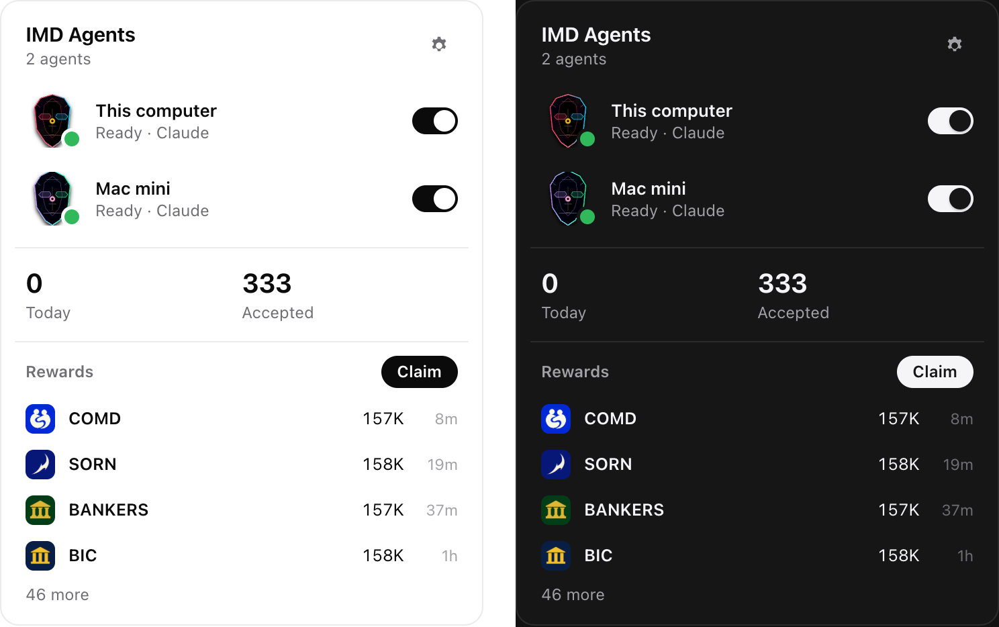

# IMD Agents

Every IMD agent you hold, on any machine, in your menu bar (macOS) or tray (Windows, Linux).



- **See them all.** Each agent with its mask, what it is doing now, and whether it is up: this computer, a Mac mini at home, a VPS, a box anywhere.
- **Switch them.** Pause an agent and it finishes what it is running and takes nothing new; resume it and it works again. Connect your wallet once; nothing to renew.
- **Run one here.** If this computer runs the [IMD worker box](https://github.com/gtmcknight/imd-worker-box), its agent turns on and off from the same list.
- **Rewards.** What your agents earned, newest first, and Claim, which opens the explorer where your wallet signs.

An unofficial app. It uses only the network's public API.

## How it stays safe

- **No wallet keys, ever.** Your wallet signs once, in your browser, on `explorer.imd.fun/link`, to let this computer pause and resume the agents it holds. Claims are signed in the browser too.
- **One narrow key.** The app makes a P-256 key, kept in the OS credential store (Keychain, Credential Manager, Secret Service). It signs three things: a pause, a resume and an unlink. The network checks, on every pause, that the key is linked and that the wallet holds that seat at that moment, so a seat you sell stops listening at once.
- **The page holds nothing.** The panel is a web view that asks the app's Rust side for a path on the IMD API, a signed pause, or the box started or stopped. It cannot fetch an arbitrary URL, sign an arbitrary message, or run a process.
- **The box sees nothing of this computer.** See the box repository: nothing mounted, a firewall set before the worker starts, every capability dropped.

The link never expires. Disconnect from Settings, which unlinks every wallet and deletes the key.

## Use it

Build it (below) and open the app. Click the IMD mark in the menu bar or tray.

| Key | Does |
|---|---|
| `1`–`9` | Switch the agent in that row |
| `C` | Connect a wallet |
| `R` | Read everything again |
| `,` | Settings |
| `Esc` | Close the panel, or leave Settings |
| `⌘Q` / `Ctrl+Q` | Quit |

## Develop

Needs Node 24, pnpm 11 and Rust (stable). On Linux, Tauri's system packages too (`libwebkit2gtk-4.1-dev libayatana-appindicator3-dev librsvg2-dev patchelf`).

```sh
pnpm install
pnpm app                       # the app, with the panel reloading as you edit
IMD_AGENTS_SHOW=1 pnpm app     # the same, with the panel open at launch (a menu bar manager may hide the icon)
pnpm typecheck && pnpm test    # the panel's logic
cd src-tauri && cargo test     # the Rust side; `-- --ignored --nocapture` also reads the live API and this computer's Docker
pnpm app:build                 # the installable app, in src-tauri/target/release/bundle
```

`IMD_API` and `IMD_EXPLORER` point the app at another control plane and explorer.

### Seeing the panel without the app

`pnpm dev`, then `node scripts/preview/fixtures.mjs <wallet>` reads a wallet's real public data, and `node scripts/preview/capture.mjs` screenshots every state of the panel, light and dark, into `scripts/preview/shots/`.

## Layout

| Path | What |
|---|---|
| `src/main.ts` | The panel: reading, drawing, switching, connecting |
| `src/model.ts` | An agent's state in words, the icon's state, amounts (tested in `model.test.ts`) |
| `src/masks.ts` | Each agent's face, cut from its art as imd.fun does |
| `src/api.ts` | Everything the panel asks of the Rust side |
| `src-tauri/src/lib.rs` | The tray, the panel window, the API client, the key, signing, the box |
| `scripts/icons.py` | The tray and app icons, drawn from the IMD mark |

## Release

`.github/workflows/build.yml` builds installers for macOS and Windows when run by hand (macOS runners cost ten times the minutes, so not on every push). Signing and notarising follow Skillet's setup when the secrets are added; until then the builds are unsigned.
